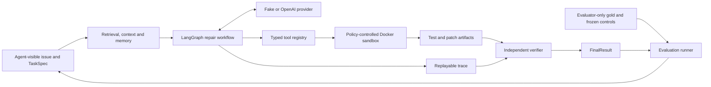

# RepoPilot

[English](README.md) · [简体中文](README.zh-CN.md)

An evaluation-driven coding agent that investigates repository issues, proposes bounded
patches, and verifies repairs with independent test evidence.

RepoPilot connects the full loop from issue reproduction to code retrieval, inspection,
patching, and validation. Its focus is the engineering around the agent: constrained tool
access, isolated execution, replayable traces, context budgets, and reproducible evaluation.

**Status: under active development.** P0–P6 and P7-S1–S5 are complete according to the
development records. The P7-S6 formal runner and environment checks are implemented;
the planned 32 holdout runs have **not started (0/32)**. No formal holdout repair rate
or retrieval improvement is claimed.

## What is implemented

- **Repair workflow:** a LangGraph state machine runs
  `reproduce → search → inspect → patch → validate → finish`, with typed tool contracts
  and step, token, time, and estimated-cost budgets.
- **Repository retrieval:** Python AST and text chunking, BM25, dense retrieval, and
  Reciprocal Rank Fusion; Jina embedding and PostgreSQL/pgvector adapters; optional
  bounded query rewriting.
- **Isolated execution:** digest-pinned Docker images, no host bind mounts, a non-root
  user, a read-only root filesystem, resource limits, and policy-approved command argv.
  Agent execution uses no network by default.
- **Evidence and recovery:** SHA-256-protected traces and artifacts, offline replay,
  an independent rule-based verifier, and explicit interruption recovery. A model's
  completion message alone cannot establish a successful repair.
- **Context and memory:** per-source token budgets, artifact offloading, working-memory
  checkpoints, repository memory with commit/content invalidation, and verifier-gated
  episodic memory with development/holdout namespace isolation.
- **Evaluation controls:** frozen datasets and experiment identities, agent/evaluator
  gold separation, comparable baseline adapters, and an append-only resumable runner.

**Stack:** Python 3.12 · LangGraph · Pydantic · OpenAI SDK · Docker · PostgreSQL/pgvector ·
Jina embeddings · pytest · Ruff · mypy · uv.

## Architecture



The agent sees the issue and its permitted repository/test inputs. Expected patches and
gold file labels belong to the evaluator and are excluded from agent prompts and indexes.

## Quick start

Install Python 3.12 and [uv](https://docs.astral.sh/uv/), then run from the repository root:

```bash
uv sync --locked

# Deterministic agent fixture: no API key, Docker, or database required.
uv run repopilot run-fixture \
  --manifest tests/fixtures/p1_agent_manifest.json \
  --output-dir results/p1-fixture \
  --config configs/default.yaml

# Verify the generated trace without executing tools or calling a model.
uv run repopilot replay --trace results/p1-fixture/trace.json
```

The fixture demonstrates orchestration and replay using scripted providers and sandbox
responses. It does not perform a real repair; its terminal result is
`stopped/agent_stopped`.

Inspect the CLI and run ordinary checks:

```bash
uv run repopilot --help
uv run pytest -q
uv run ruff check .
uv run ruff format --check .
uv run mypy src/repopilot
```

Tests that require real Docker images, a database, or a model are explicitly gated and
skip when their prerequisites are absent. Ordinary CI needs no model secrets.

Real repair execution additionally requires an already-local digest-pinned Docker image
and an agent-only task file. Dense retrieval requires the optional Jina runtime and a
configured vector backend. See the [technical guide](docs/technical-guide.md) for exact
contracts, configuration, and commands. `.env.example` contains blank API key fields and
local development defaults; supply real credentials only through your local environment.

## Evaluation evidence and limits

| Evidence | Recorded scope | What it establishes |
| --- | --- | --- |
| [BM25 baseline](results/p2-baseline/summary.md) | 3 synthetic tasks; Recall@1/3/5 and MRR = 1.0 | Localization metric and artifact plumbing on deliberately separable fixtures |
| [Retrieval comparison](results/p3-retrieval-comparison/retrieval-comparison.md) | BM25, dense, and hybrid on the same 3 synthetic tasks with fake embeddings | Ranking, fusion, and comparison accounting |
| [Final dev calibration](results/p7-dev/calibration-report-v5.json) | 2 development fixtures × 4 arms × 1 repetition; 5 verified successes and 3 invalid-patch outcomes | Connected repair/evaluation execution on a small development set |
| [Sandbox qualification](results/p7-holdout/sandbox-matrix-preflight-v1.json) | 8 SWE-bench Lite tasks on Linux amd64; failing baseline and passing evaluator gold | Compatibility of task environments and test execution |
| Formal holdout | 8 tasks × 4 default arms = 32 planned slots; 0 executed | Pending; no aggregate agent performance result |

The final dev report records an estimated USD **0.546178750** for its eight attempts;
this is the recorded application estimate for that calibration, not the total development
spend or a current API price. These small fixture and qualification checks do not establish
production performance or superiority over another coding agent.

This repository is a publication snapshot. It retains selected reports and regression
inputs, but omits raw local dev traces, private dev spending approvals, and the original
Git history. Historical hashes and source commits remain as provenance. Reports referencing
omitted raw executions cannot be independently replayed from this snapshot alone.
The formal holdout controls also depend on original history and private image infrastructure;
a fresh clone is not a ready-to-run reproduction of that frozen paid experiment.

## Repository map

| Path | Purpose |
| --- | --- |
| `src/repopilot/` | Agent, retrieval, sandbox, providers, verifier, context, memory, and evaluation |
| `tests/` | Unit, integration, security tests, and deterministic fixtures |
| `configs/` | Default profiles, baseline settings, and versioned experiment matrices |
| `scripts/` | Dataset freezing, calibration, and formal evaluation controllers |
| `data/` | Frozen evaluation manifests and empty memory namespace manifests |
| `results/` | Selected historical summaries, qualification evidence, and regression inputs |
| `docs/` | Architecture, technical reference, status, threat model, and evaluation contracts |
| `migrations/` | pgvector schema migration |

Start with the [architecture](docs/architecture.md), [development status](docs/development-status.md),
[technical guide](docs/technical-guide.md), [threat model](docs/threat-model.md),
[baseline contracts](docs/baselines.md), and [experiment design](docs/experiments.md).
The [publication notes](docs/publication-notes.md) describe what was selected for this snapshot.
See [publication validation](docs/validation.md) for the checks actually run on this copy.

## Roadmap

- Execute and retain all 32 frozen holdout slots, including failures and interrupted attempts.
- Complete P7-S7 aggregation with explicit denominators, cost/latency reporting, and bad-case analysis.
- Finish P8 documentation and reproducibility checks against the measured evidence.

## License and attribution

RepoPilot's original code is licensed under [MIT](LICENSE), consistent with its package
metadata. Evaluation excerpts and patches from upstream projects retain their respective
licenses; see [third-party notices](THIRD_PARTY_NOTICES.md) and the
[frozen dataset description](data/manifests/p7-v1/README.md).
