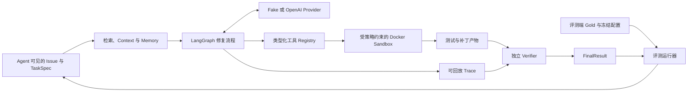

# RepoPilot

[English](README.md) · [简体中文](README.zh-CN.md)

一个围绕评测构建的 Coding Agent：复现仓库 Issue、定位代码、生成受限补丁，并用独立测试证据验证修复。

RepoPilot 将问题复现、代码检索、源码检查、补丁应用和验证连成完整流程。项目重点是 Agent 周围的工程机制：工具权限、隔离执行、可回放轨迹、Context 预算，以及可追溯的评测。

**当前仍在开发。** 根据开发记录，P0–P6 与 P7-S1–S5 已完成；P7-S6 的正式运行器和环境检查已实现，但计划中的 **32 次 Holdout 正式运行尚未开始（0/32）**。目前不报告正式 Holdout 修复率或检索提升结论。

## 已实现能力

- **修复流程：** 用 LangGraph 状态机组织 `reproduce → search → inspect → patch → validate → finish`，工具调用有类型契约，并受步数、Token、时间和估算成本预算约束。
- **仓库检索：** Python AST 与文本切块、BM25、Dense 和 RRF Hybrid；连接 Jina Embedding 与 PostgreSQL/pgvector，支持有次数和输入范围限制的查询改写。
- **隔离执行：** 使用固定 digest 的 Docker 镜像、非 root 用户、只读根文件系统、资源限制和经过策略验证的命令参数；不挂载宿主机目录，Agent 默认无网络。
- **证据与恢复：** 保留带 SHA-256 校验的 Trace 和产物，支持离线回放、独立规则 Verifier 和显式中断恢复。模型声称完成任务，不足以判定修复成功。
- **Context 与 Memory：** 按来源分配 Token 预算，将大输出转为产物引用；提供 Working Memory 检查点、按 commit/content 失效的 Repository Memory，以及通过 Verifier 才能写入的 Episodic Memory。开发集与 Holdout 使用隔离命名空间。
- **评测控制：** 冻结数据集和实验身份，隔离 Agent 与评测端 Gold，提供可比较的基线适配器和只追加、可恢复的评测运行器。

**技术栈：** Python 3.12 · LangGraph · Pydantic · OpenAI SDK · Docker · PostgreSQL/pgvector · Jina Embedding · pytest · Ruff · mypy · uv。

## 架构



Agent 只能接收 Issue 和允许使用的仓库、测试输入；预期补丁与 Gold 文件标签属于评测端，不进入 Agent Prompt 或检索索引。

## 快速开始

安装 Python 3.12 与 [uv](https://docs.astral.sh/uv/)，在仓库根目录执行：

```bash
uv sync --locked

# 确定性 Agent 示例，无需 API Key、Docker 或数据库。
uv run repopilot run-fixture \
  --manifest tests/fixtures/p1_agent_manifest.json \
  --output-dir results/p1-fixture \
  --config configs/default.yaml

# 回放并校验 Trace，不执行工具，也不调用模型。
uv run repopilot replay --trace results/p1-fixture/trace.json
```

该示例使用预设 Provider 和 Sandbox 响应，演示编排与回放；它没有执行真实修复，最终状态为 `stopped/agent_stopped`。

查看 CLI 并运行常规检查：

```bash
uv run repopilot --help
uv run pytest -q
uv run ruff check .
uv run ruff format --check .
uv run mypy src/repopilot
```

依赖真实 Docker 镜像、数据库或模型的测试，在缺少前置条件时明确跳过；普通 CI 无需模型密钥。

真实修复还需要本地已有、固定 digest 的 Docker 镜像，以及只含 Agent 可见字段的任务文件。Dense 检索需要可选 Jina 运行时和向量数据库。完整配置与命令见[技术指南](docs/technical-guide.md)。`.env.example` 仅包含空 API Key 字段及本地开发默认值，实际凭据由本地环境提供。

## 评测证据与边界

| 证据 | 记录范围 | 可以说明什么 |
| --- | --- | --- |
| [BM25 基线](results/p2-baseline/summary.md) | 3 个合成任务，Recall@1/3/5 与 MRR 均为 1.0 | 易区分 fixture 上的定位指标与产物流程正确 |
| [检索对照](results/p3-retrieval-comparison/retrieval-comparison.md) | 同一组 3 个合成任务，使用 Fake Embedding 比较 BM25、Dense、Hybrid | 排名、融合和对照统计机制可运行 |
| [最终开发集校准](results/p7-dev/calibration-report-v5.json) | 2 个开发 fixture × 4 个实验臂 × 1 次重复；5 次验证成功，3 次 invalid-patch | 小规模开发集上的修复与评测链路已接通 |
| [Sandbox 环境验证](results/p7-holdout/sandbox-matrix-preflight-v1.json) | Linux amd64 上的 8 个 SWE-bench Lite 任务，Baseline 失败、评测端 Gold 通过 | 任务环境兼容性与测试执行路径可用 |
| 正式 Holdout | 8 个任务 × 4 个默认实验臂，共 32 个计划槽位；已执行 0 个 | 尚待运行，暂无 Agent 综合性能结论 |

最终开发集报告记录这 8 次尝试的应用侧估算成本为 **USD 0.546178750**；它不是开发总花费，也不是当前 API 价格。这些小样本 fixture 和环境检查不能证明生产性能，也不能证明优于其他 Coding Agent。

本仓库是用于公开展示的项目快照：保留选定报告与回归输入，省略本地开发原始 Trace、私人开发费用授权及原 Git 历史。历史 hash 和 source commit 保留作来源标记；引用已省略原始运行文件的报告，无法仅凭本快照独立回放。正式 Holdout 控制器还依赖原历史与私人镜像设施，新 clone 不能直接复现原先冻结的付费实验。

## 目录

| 路径 | 用途 |
| --- | --- |
| `src/repopilot/` | Agent、检索、Sandbox、Provider、Verifier、Context、Memory 与评测实现 |
| `tests/` | 单元、集成、安全测试和确定性 fixture |
| `configs/` | 默认配置、基线配置与版本化实验矩阵 |
| `scripts/` | 数据集冻结、开发集校准和正式评测控制器 |
| `data/` | 冻结评测 Manifest 与空 Memory 命名空间 Manifest |
| `results/` | 选定历史摘要、环境证据和回归输入 |
| `docs/` | 架构、技术指南、进度、威胁模型与评测契约 |
| `migrations/` | pgvector 数据库迁移 |

建议先阅读[架构](docs/architecture.md)、[开发进度](docs/development-status.md)、[技术指南](docs/technical-guide.md)、[威胁模型](docs/threat-model.md)、[基线契约](docs/baselines.md)和[实验设计](docs/experiments.md)。[公开快照说明](docs/publication-notes.md)记录了文件选择与省略范围。

本副本实际执行过的检查见[公开快照验证](docs/validation.md)。

## 后续计划

- 运行并保留全部 32 个冻结 Holdout 槽位，包括失败与中断尝试。
- 完成 P7-S7 汇总，明确分母、成本、延迟和失败案例。
- 完成 P8 文档与复现检查，使结论与实测证据一致。

## 许可与来源

RepoPilot 自有代码按 [MIT](LICENSE) 许可，与包元数据保持一致。上游项目的评测片段及补丁保留各自许可，详见[第三方来源说明](THIRD_PARTY_NOTICES.md)和[冻结数据集说明](data/manifests/p7-v1/README.md)。
